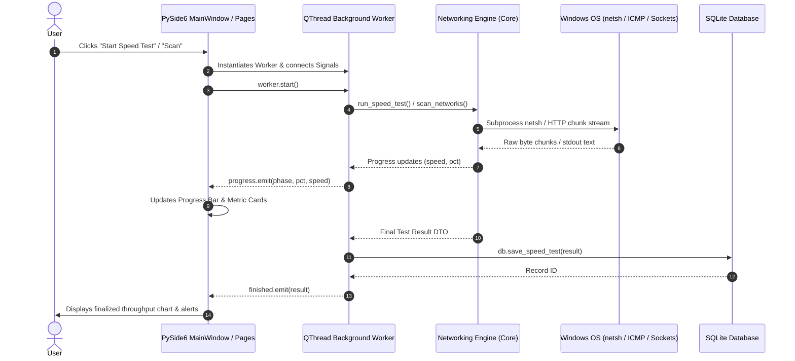
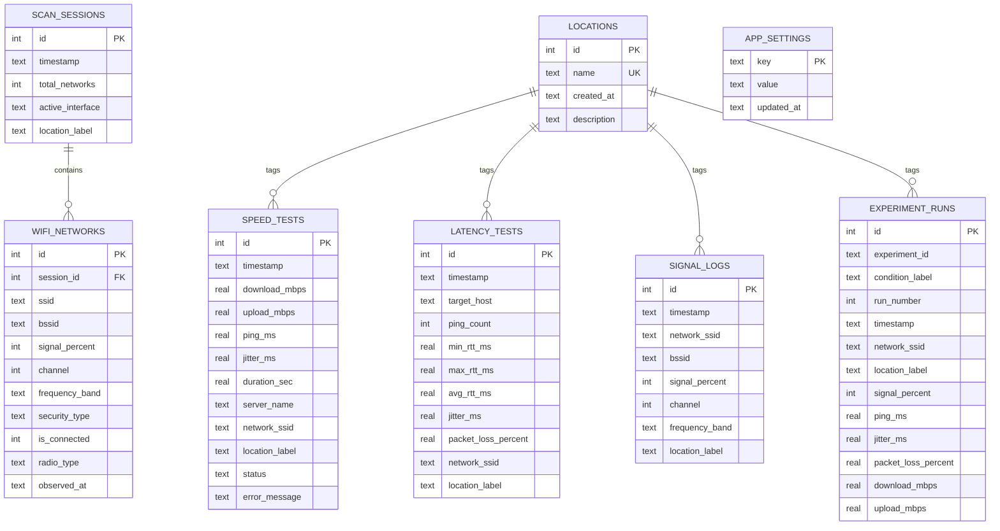

# NetVision — Software Architecture & Technical Design Document

> **Document Version**: 2.0.0  
> **Target Platform**: Windows 10 & 11 (64-bit)  
> **Engineering Discipline**: Desktop Application Architecture & Computer Networking  
> **Runtime Environment**: Python 3.10-3.12 / PySide6 (Qt 6.7+) / PyInstaller Standalone  

---

## 🏛️ 1. Architectural Style: Layered MVC with Asynchronous Workers

NetVision follows an **Enterprise Layered Model-View-Controller (MVC)** architectural pattern, decoupled across four primary tiers:

```text
┌─────────────────────────────────────────────────────────────┐
│                    PRESENTATION TIER (UI)                   │
│   MainWindow, QStackedWidget Pages, Reusable Cards, Charts  │
└──────────────────────────────┬──────────────────────────────┘
                               │ Qt Signals & Slots
┌──────────────────────────────▼─────────────────────────────┐
│               CONTROLLER & WORKER THREAD TIER              │
│   WifiScanWorker, SpeedTestWorker, LatencyTestWorker,      │
│   SignalMonitorWorker, ExperimentWorker (QThread)          │
└──────────────────────────────┬──────────────────────────────┘
                               │ Python API Calls
┌──────────────────────────────▼─────────────────────────────┐
│                  CORE ENGINE & DOMAIN TIER                 │
│   WifiScanner, LatencyMonitor, SpeedTester,                │
│   ChannelAnalyzer, RecommendationEngine, ReportGenerator   │
└──────────────────────────────┬──────────────────────────────┘
                               │ SQLite SQL Queries
┌──────────────────────────────▼─────────────────────────────┐
│                   PERSISTENCE TIER (DATA)                  │
│        SQLite 3 Relational DB (WAL Mode, Indices)          │
└─────────────────────────────────────────────────────────────┘
```

---

## 📁 2. Source Code Organization (`src/` Layout)

The codebase strictly adheres to the standard `src/netvision` layout:

```text
NetVision/
├── src/
│   └── netvision/               # Application root package
│       ├── __init__.py          # Package metadata (__version__ = "2.0.0")
│       ├── config.py            # LocalAppData path resolver & directory setup
│       ├── core/                # Core measurement services (non-GUI)
│       │   ├── latency_monitor.py      # ICMP ping & TCP latency probes
│       │   ├── wifi_scanner.py         # netsh wlan scanner & parsing
│       │   ├── speed_test.py           # Multi-stream HTTP throughput engine
│       │   ├── report_generator.py     # ReportLab PDF report builder
│       │   └── export_manager.py       # CSV and JSON telemetry exporter
│       ├── database/            # Persistent SQLite database layer
│       │   ├── db_manager.py           # SQLite connection pool & migrations
│       │   └── schema.py               # Table definitions & DDL scripts
│       └── ui/                  # PySide6 desktop GUI
│           ├── main_window.py          # Shell window, sidebar, and status bar
│           ├── components/             # Reusable UI widgets & live charts
│           │   ├── chart_widget.py     # Matplotlib live canvas
│           │   └── ...
│           └── pages/                  # Navigation pages
│               ├── dashboard_page.py   # System overview & live telemetry
│               ├── latency_page.py     # Latency graphs & packet loss tracking
│               ├── wifi_page.py        # Wi-Fi network inspector
│               ├── heatmap_page.py     # Interactive RF signal heatmap
│               ├── speedtest_page.py   # Bandwidth test controls & gauge
│               ├── reports_page.py     # PDF report generation & export
│               ├── settings_page.py    # Target hosts & threshold options
│               └── about_page.py       # System diagnostics & telemetry
├── assets/                      # Application icons and visual assets
├── data/                        # Template SQLite database (seeded on first run)
├── docs/                        # Complete technical documentation
├── installer/                   # Standalone installer & Inno Setup scripts
├── scripts/                     # Build automation (PyInstaller, packaging)
└── tests/                       # Automated pytest test suite
```

---

## 🔄 3. Data Flow Architecture



---

## 🗄️ 4. Relational Database Schema & ER Design

NetVision uses a properly normalized relational SQLite schema with foreign key integrity enabled and `PRAGMA journal_mode=WAL` for zero database locks during concurrent reads and writes.



---

## 🧵 5. Threading & Concurrency Architecture

### Why Multithreading is Mandatory
In desktop GUI applications, the operating system dispatches window messages (mouse movements, paint events, button clicks) to the application's Main Event Loop.
- If an application executes a synchronous network call on the main thread (such as waiting 1.5 seconds for an ICMP ping response or downloading 15 MB over HTTP), the event loop is blocked.
- Windows detects the unresponsive event loop within 2 seconds and marks the window title bar as **"Not Responding"**.

### NetVision Solution
NetVision isolates every long-running I/O operation into dedicated `QThread` instances:
1. **`WifiScanWorker`**: Executes `netsh wlan show networks mode=bssid` and parses output in background.
2. **`SpeedTestWorker`**: Streams binary HTTP payloads and tracks throughput without dropping frames.
3. **`LatencyTestWorker`**: Sends sequential ICMP probes with cancellation support.
4. **`SignalMonitorWorker`**: Continuously polls active link parameters at timed intervals.
5. **`ExperimentWorker`**: Orchestrates repeated multi-trial test sequences.

### Safe Application Lifecycle Management
On application shutdown (`closeEvent`), `MainWindow` signals all active workers to terminate and waits up to 1000ms for each worker thread to cleanly release socket descriptors and subprocess handles, avoiding zombie processes or database locking issues.

---

## 💾 6. Runtime Path Resolution & User Data Isolation

NetVision strictly decouples static application binaries from dynamic user telemetry:

### Dynamic Path Resolution (`config.py`)
```python
def get_app_dir() -> Path:
    """Returns application assets root (handles PyInstaller sys._MEIPASS)."""
    if getattr(sys, "frozen", False):
        return Path(getattr(sys, "_MEIPASS", Path(sys.executable).parent))
    return Path(__file__).resolve().parent.parent.parent

def get_user_data_dir() -> Path:
    """Returns persistent writable user directory under %LOCALAPPDATA%\\NetVision."""
    local_appdata = os.environ.get("LOCALAPPDATA")
    if local_appdata:
        return Path(local_appdata) / "NetVision"
    return Path.home() / "AppData" / "Local" / "NetVision"
```

### Runtime Storage Hierarchy
```text
%LOCALAPPDATA%\NetVision\
├── database\
│   └── netvision.db         # Persistent SQLite database in WAL mode
├── logs\
│   └── netvision.log        # Timestamped diagnostic logs
├── reports\
│   └── NetVision_Report_*.pdf # Exported PDF technical reports
├── exports\
│   └── *.csv, *.json        # Raw data exports
├── config\
│   └── settings.json        # User preferences and probe target list
└── cache\
    └── ...                  # Heatmap interpolation grids and temp files
```

### Safe Seeding Protocol
On first launch, `ensure_app_directories()` creates required subfolders. If `netvision.db` does not exist, it safely seeds from `data/netvision.db` template without overwriting existing user scan data.

---

## 🛡️ 7. Error Handling & Measurement Integrity Rules

1. **ICMP Probe Integrity**:
   - Missing or timed-out ICMP packets count strictly as lost probes.
   - TCP handshake fallback is never silently mixed into ICMP RTT datasets.
   - Hostnames and IP addresses are strictly validated before subprocess execution.
2. **Missing vs Failed Measurements**:
   - Missing measurements are represented as `NULL` in the database and `"—"` or `"No data"` in the UI.
   - Failed measurements are never represented as `0.0`.
3. **Wi-Fi Scanner Resilience**:
   - Handles missing wireless adapters gracefully without crashing.
   - Parses multi-BSSID networks with identical SSIDs into distinct access point records.
4. **Bandwidth Measurement Accuracy**:
   - Measures actual downloaded byte chunks over high-resolution elapsed time.
   - Separates warm-up phase from measurement phase to eliminate TCP slow-start skew.
